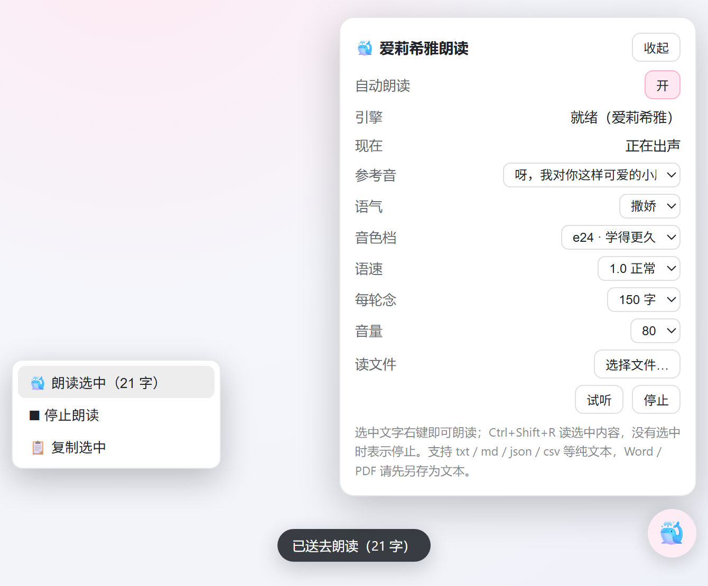

# dsh-elysia-tts

[](https://github.com/Zfuji/dsh-elysia-tts/actions/workflows/test.yml)
[](LICENSE)
[](package.json)

[中文](README.md) | English

A DeepSeek Harness (DSH) plugin that reads completed assistant turns aloud with a locally hosted
[GPT-SoVITS](https://github.com/RVC-Boss/GPT-SoVITS) voice: watch live sessions → take the last
text-bearing assistant message of each completed turn → synthesize → play through `ffplay`.



> This repository ships **code only**. Voice models, reference audio and the real `lib/presets.json`
> are not distributed here — bring your own (see “Reference presets”). Character voices are for
> personal use only.

## Install

Add the package to a DSH profile (`%DSH_HOME%\profiles\<name>\package.json`) and include it in the
bundle list:

```jsonc
{
  "dependencies": {
    "dsh-elysia-tts": "https://codeload.github.com/Zfuji/dsh-elysia-tts/tar.gz/refs/heads/main"
  },
  "dsh": { "profile": { "bundles": ["…", "dsh-elysia-tts"] } }
}
```

Restart DSH and the 🐳 button appears in the bottom-right corner. For local development use
`link:D:/path/to/dsh-elysia-tts` instead.

Prerequisites: a GPT-SoVITS bundle, your own voice weights, `ffplay` on `PATH`, and a
`lib/presets.json` copied from `lib/presets.example.json`.

## What gets read

- Only turns that finish successfully (`turn/end` with `reason.kind === 'completed'`).
- Only the **last** text-bearing assistant message of a turn — intermediate “let me check…” steps
  and tool-call-only messages are skipped.
- Subagent sessions (`header.origin === 'subagent'`) are ignored.
- Code fences, inline code, links, URLs, HTML, markdown tables and emoji are stripped first.
- Long replies are read **from the tail** (`trim: "tail"`) — the conclusion is at the end.
- Each synthesized segment is capped at 45 characters (split on punctuation where possible).

## Latency: what actually helps

CPU inference is slower than playback (RTF ≈ 1.6–2.0 measured), so the plugin avoids adding more delay:

1. **Short replies are synthesized as one piece** (≤ `shortReplyChars`, default 60) — zero gaps between segments.
2. **Streaming** for longer replies: one request, segmented server-side by punctuation (`cut5`), raw PCM into a single `ffplay`. First audio arrives in ~4.6 s instead of ~13.5 s.
3. **Silence squeezing**: model output carries ~0.45 s of trailing silence per segment; long silences are capped at `maxSilenceMs` (200 ms).
4. **`fragment_interval` 0.3 → 0.05**: the server inserts 0.3 s between cut5 segments. Measured on a four-sentence reply: audio 15.36 s → 12.66 s, internal pauses 4.81 s → 2.84 s.
5. **Read the socket eagerly**, never `await` the player while reading: otherwise TCP back-pressure throttles generation (a 40 s job became 50 s).

`/stop` really stops playback and cancels the in-flight request. Note that the server-side inference
already in progress cannot be interrupted (FastAPI runs it synchronously); that sentence finishes in
the background.

## Reference presets and voice styles

`lib/presets.json` (git-ignored) lists your reference clips:

```jsonc
{
  "version": 1,
  "dir": "D:\\GPT-SoVITS\\refs",
  "presets": [
    { "id": "p01", "emotion": "普通", "label": "normal", "text": "exact transcript of the clip", "file": "ref-normal.wav", "dur": 5.0 }
  ]
}
```

Picking a reference clip: 3–7 s, internal pauses ≤ 0.5 s, transcript must match the audio word for
word. The panel groups clips by `emotion`; styles that carry an emotion (“sweet”, “tease”, “playful”,
“tender”) switch to the first clip of that group automatically.

| Style | temperature / top_k / top_p | Switches reference audio |
|---|---|---|
| stable | 0.80 / 15 / 0.85 | no |
| natural | 0.90 / 20 / 0.90 | no |
| lively | 0.95 / 10 / 0.90 | no |
| sweet | 0.95 / 15 / 0.90 | yes |
| tease | 0.90 / 15 / 0.90 | yes |
| playful | 1.00 / 20 / 0.90 | yes |
| tender | 0.75 / 15 / 0.85 | yes |
| calm | 0.70 / 10 / 0.80 | no |

## Selecting text

Select any text → right-click → **read selection / stop / copy**. Or press **Ctrl+Shift+R** (reads
the selection, or stops when nothing is selected). The `/say` endpoint accepts `"full": true` to skip
the per-turn character budget (capped at 2000 chars).

## Reading a file

Click **选择文件… (choose file)** in the panel and pick a plain-text file (txt / md / json / csv / log /
srt / vtt / yaml / html). The client reads it in the browser (4 MB cap), the host cleans it, splits it
into ~600-character chunks (
eadChunkChars) and queues them one by one. The panel shows
读文件 3/12 while it plays, and **停止** clears the whole job.

One job is capped at 
eadMaxChars (default 20 000 characters ≈ 25 minutes of synthesis); anything
beyond is truncated and flagged in the toast. File-reading chunks are **not** subject to the
“drop the oldest when the queue is full” rule, so a new reply cannot evict them mid-file.

> Word / PDF are not supported yet — save them as .txt first. Browser-side extraction is unreliable
> and the host deliberately avoids adding a document-parsing dependency.

## Configuration

`%DSH_HOME%\elysia-tts.json` — only the keys you want to override:

| Key | Meaning |
|---|---|
| `auto` | read every completed turn |
| `maxChars` | characters per turn (default 150; 80 is noticeably smoother when RTF > 1) |
| `trim` | `"tail"` (default) or `"head"` |
| `streaming` | streaming playback (default true) |
| `shortReplyChars` | replies up to this length are synthesized as one piece (default 60, 0 disables) |
| `readMaxChars` / `readChunkChars` | file-reading cap (default 20 000 chars) / chunk size (default 600) |
| `fragmentInterval` | silence inserted between server-side segments (default 0.05 s) |
| `volume` | playback volume 0–100 |
| `sameSiteOnly` | reject cross-site requests (default true) |
| `trimSilence` / `maxSilenceMs` | silence squeezing (default on, 200 ms) |
| `sampleRate` | synthesis sample rate (32000 for v2 models) |
| `gptWeights` / `sovitsWeights` / `sovitsBase` | model paths |
| `presetDir` / `refAudio` / `promptText` | reference clip dir / current clip / its transcript |
| `temperature` / `topK` / `topP` / `seed` | sampling; `seed >= 0` makes one sentence reproducible |
| `style` | `stable` / `natural` / `lively` / `sweet` / `tease` / `playful` / `tender` / `calm` / `custom` |
| `speed` | speed factor (server-side `atempo`; it does **not** reduce synthesis time) |
| `maxQueue` | queued turns; the oldest is dropped when full (`dropped` counter) |

## Local HTTP API

Only bound to `127.0.0.1`, same-origin by default (cross-site requests get 403).

- `GET /elysia-tts/status`
- `POST /elysia-tts/say {"text":"…","full":true}`
- `POST /elysia-tts/read {"name":"a.txt","text":"…"}` — queue a file; progress in `/status` → `read`
- `POST /elysia-tts/stop`
- `POST /elysia-tts/config {…}`
- `POST /elysia-tts/auto`, `POST /elysia-tts/warmup`
- `GET /elysia-tts/presets`, `POST /elysia-tts/preset {"ref":"p01"|"style":"sweet"|"volume":60}`

## Performance (this machine, CPU only, fp32)

| Case | Synthesis | Audio |
|---|---|---|
| 2 chars | 2.4–2.6 s | 0.4–0.9 s |
| 17 chars | 10.7 s | 5.18 s |
| 23 chars (lively) | 13.0 / 16.7 s | 7.42 / 8.46 s |
| 23 chars (stable) | 8.2 / 9.6 s | 7.30 / 7.50 s |
| 115 chars (streaming, 3 segments) | ≈39 s total | 24.6 s → 22.7 s after trimming |

Fixed cost per request ≈ 2.4 s. `parallel_infer: true` shows no consistent gain; e16/e24 are equally
fast; per-segment loudness variation is only ~1 dB, so no normalization is applied.

## Development

```bash
npm ci
cp lib/presets.example.json lib/presets.json
npm test           # 20 cases: helpers + integration
npm run lint       # oxlint, 0 warnings required
npm run format:check
```

Structure: `index.js` (config / engine lifecycle / queue / wiring), `text.js` (pure text), `scanner.js`
(session events), `player.js` (ffplay), `tts.js` (three strategies + cache + retry), `routes.js`
(HTTP API), `client.js` (web half). See [CONTRIBUTING.md](CONTRIBUTING.md).

## Credits and license

Plugin code is [MIT](LICENSE). Sources, third-party licenses and character-asset boundaries are
listed in [ACKNOWLEDGMENTS.md](ACKNOWLEDGMENTS.md). Changelog in [CHANGELOG.md](CHANGELOG.md).
